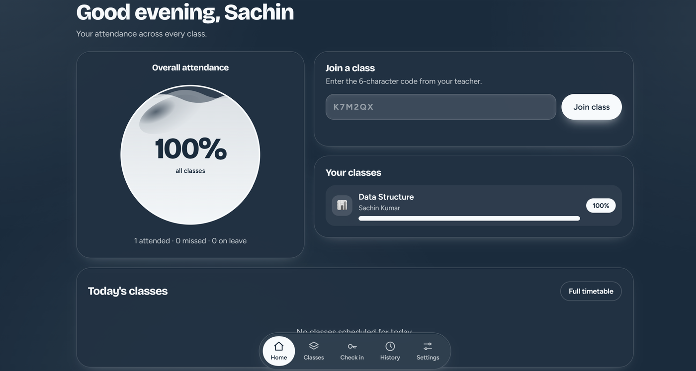
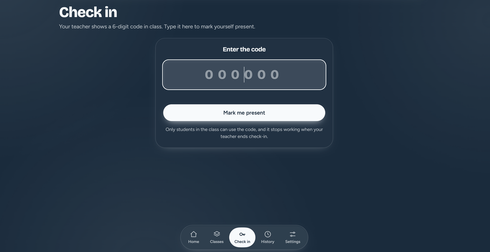
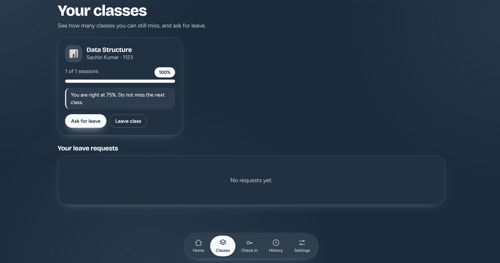
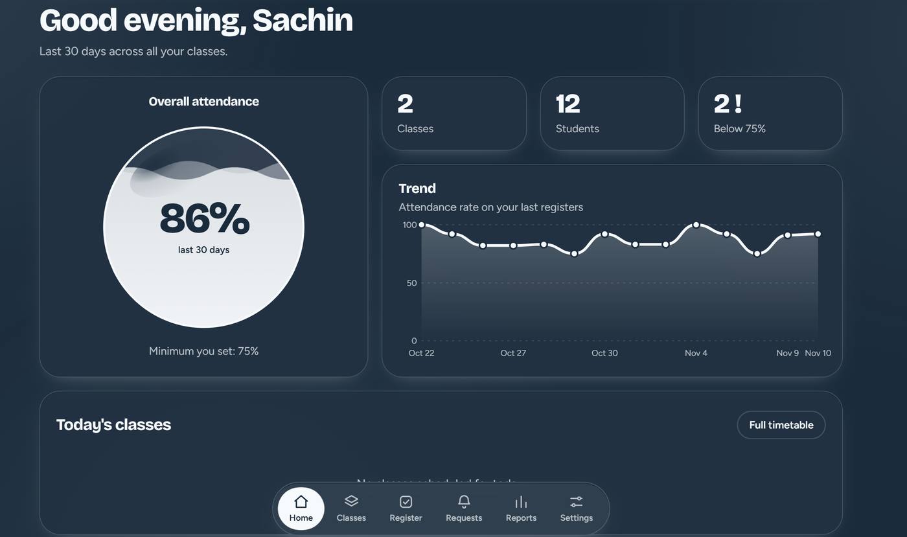
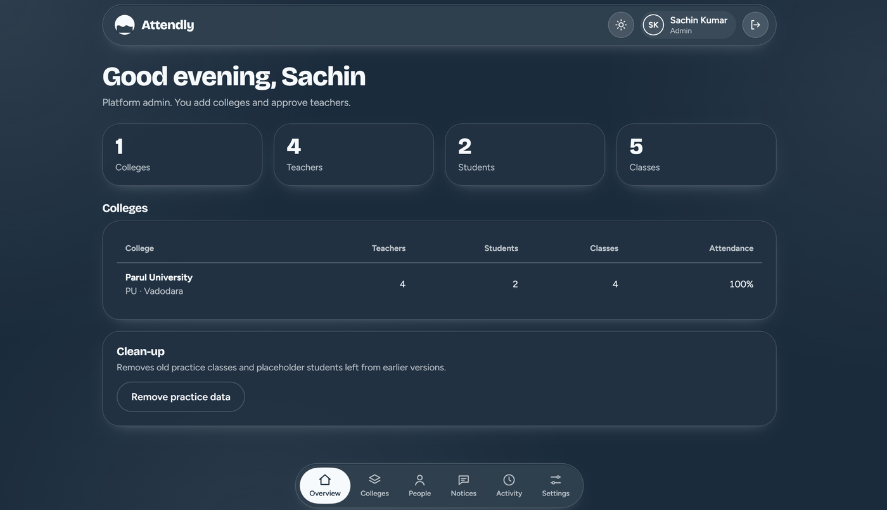

# Attendly

Attendance system for colleges: teachers take attendance, students check in with a live code, and admins manage colleges, all from one installable web app.

- **Status:** in progress
- **Live:** [attendly-attende.vercel.app](https://attendly-attende.vercel.app)
- **Built:** November 2026
- **Keywords:** JavaScript, Node.js, PostgreSQL, Neon, Vercel, PWA, REST API

## Highlights

- Built teacher and student portals: classes with a join code, attendance marked Present, Late, Absent or Leave, and a planner that tells a student how many classes they can still miss.
- Added a live check-in code: the teacher shows a 6-digit code, students type it on their phone, and it expires after 5 to 30 minutes.
- Added leave requests, gate pass, class notices, timetable, exams with marks and a help desk, all in one home screen.
- Built 4 roles: student, teacher, HOD and platform admin. Teachers need approval, students join only their own college, and old attendance is locked until the HOD allows edits.
- Secured accounts with e-mail OTP, account lock after 5 wrong passwords, scrypt password hashing, signed sessions and strict security headers. Installs on a phone as an app (PWA).

## Screenshots



Student home: overall attendance, join a class with a code, and the list of classes.



Student check-in: type the teacher's 6-digit code to be marked present.



Student classes: a hint on the next class, and ask for leave.



Teacher home: last 30 days, students below 75% and a trend line.



Admin overview: totals and attendance per college.

## Tech

- HTML, CSS, JavaScript (no framework): the whole front end is one small app in `public/`.
- Node.js serverless functions: one function serves every `/api/*` route, so Vercel runs a single function.
- PostgreSQL on Neon: the production database. A SQLite file is used for local runs.
- Nodemailer with Gmail SMTP: sends the OTP and password-reset codes.
- Vercel: hosts the site and the API.

## Run it

- Needs: Node.js 22 or newer
- Tested on: Node 22 on Linux (73 automated checks pass). Screen sizes 320 to 1280 px checked for sideways overflow.

```bash
npm install
set SHOW_OTP=true
node dev.js
```

Open http://localhost:3000. `SHOW_OTP=true` shows the e-mail code on screen, for local testing only. Run the tests with `node test/api.test.js`.

Deploy steps, environment variables and the full feature list are in [docs/SETUP.md](docs/SETUP.md).

## Hardest problem

- Problem: on phones, long e-mails and names made pages wider than the screen, and the top bar and bottom dock overlapped the content.
- Fixed by: giving every grid column `minmax(0, 1fr)` so it can shrink, wrapping long text, and checking 620 screens (teacher, student, admin, light and dark, widths 320 to 1280 px).
- Learned: a grid column grows to fit its content unless it is told it may shrink.

## Limits and next

- Not done: no SMS OTP, because SMS needs a paid provider. Mobile numbers are only stored and shown to the class teacher.
- Not done: no fees, transport or mess pass. They need real college data or payments.
- Not done: no load testing. Free hosting plans will not carry a very large college.
- Not done: the front end is plain JavaScript in one big file (`public/app.js`, about 1,300 lines).

## Author

Sachin Kumar | [GitHub](https://github.com/sachinkrcodes) | [LinkedIn](https://www.linkedin.com/in/sachinkrcodes) | Portfolio: [sachinkrcodes.vercel.app](https://sachinkrcodes.vercel.app) | sachinkrcodes@gmail.com

MIT License. See [LICENSE](LICENSE).
